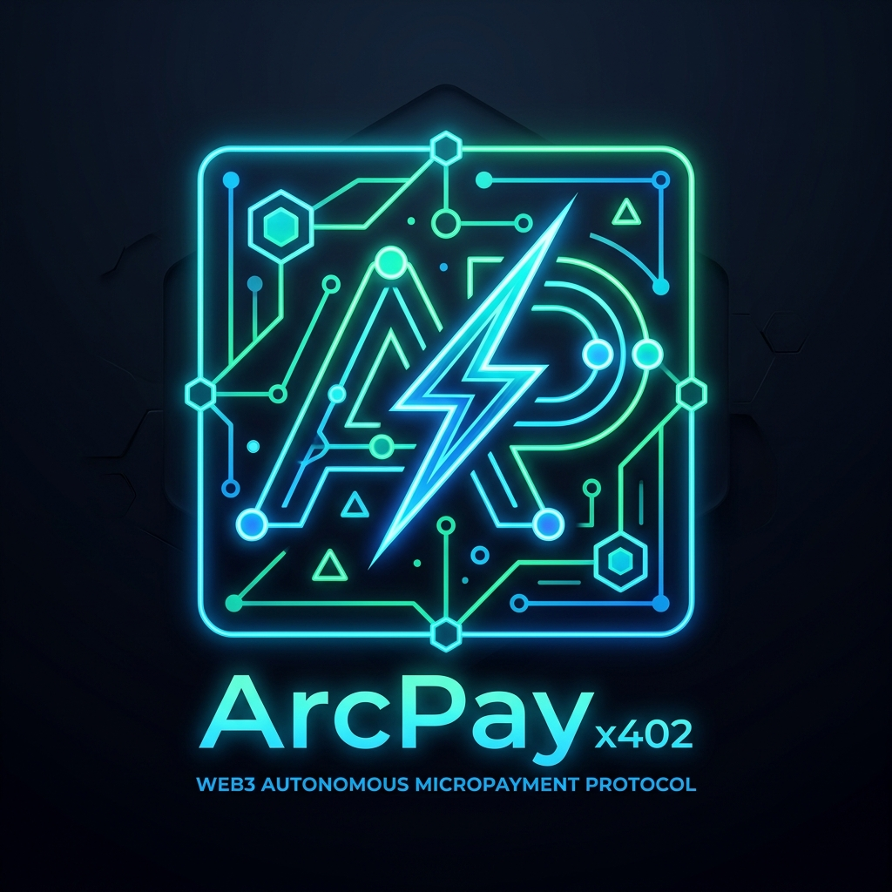

# ArcPay-x402: Autonomous Circle USDC M2M Settlement Gateway

<p align="center">
  
</p>

[](https://github.com/dextermos-dev/arc-circle-x402-gateway/actions)
[](https://opensource.org/licenses/MIT)
[](https://dorahacks.io)
[](https://www.circle.com/en/usdc)

ArcPay-x402 is an autonomous Machine-to-Machine (M2M) micropayment gateway designed for AI agents and distributed microservices. It implements standard **RFC-x402 (HTTP 402 Payment Required)** negotiation using **Circle USDC** with deterministic cryptographic receipt verification and replay attack prevention.

---

## ⚡ Key Highlights

- **RFC-x402 Native Protocol**: Intercepts unauthenticated agent API queries and responds with cryptographic 402 challenge payloads containing exact price, recipient wallet, and unique nonces.
- **Cryptographic Replay Attack Protection**: Every payment transaction hash and HMAC nonce is stored in an idempotent cache; identical transaction hashes cannot be reused.
- **Zero-KYC & Permissionless Architecture**: Operates exclusively through decentralized EVM signatures and Circle USDC contracts.
- **Micro-Services Suite Out of the Box**:
  - `/api/v1/wallet/reputation`: Autonomous Web3 wallet reputation and credit risk scoring ($1.00 USDC).
  - `/api/v1/security/contract-audit`: Static AST smart contract vulnerability scanner ($2.50 USDC).
  - `/api/v1/agent/inference`: Autonomous AI agent reasoning query ($0.50 USDC).
- **Official Settlement Wallet**: `0x8366bCe3a2D379Dec7656D7A67015789FaF999f20`

---

## 🏛️ Architecture & M2M Flow

```
┌──────────────────┐           1. GET /api/v1/wallet/reputation           ┌────────────────────────┐
│                  ├─────────────────────────────────────────────────────►│                        │
│   Client Agent   │           2. HTTP 402 Payment Required               │   ArcPay-x402 Gateway  │
│   (Autonomous)   │◄─────────────────────────────────────────────────────┤   (Provider)           │
│                  │   [Price: $1.00 USDC, Wallet, Nonce, Expire]         │                        │
└─────────┬────────┘                                                      └───────────▲────────────┘
          │                                                                           │
          │ 3. Transfer 1.00 USDC to 0x8366bCe3a2D379Dec7656D7A67015789FaF999f20     │
          ▼                                                                           │
┌─────────────────────────────────┐                                                   │
│ Circle USDC Settlement Contract ├───────────────────────────────────────────────────┤
└─────────────────────────────────┘           4. Submit Payment Receipt with TxHash   │
                                              5. Receive HMAC-signed Access Token     │
                                              6. Execute Requested Paid Service ──────┘
```

---

## 🚀 Quickstart

### Python Usage

```python
from gateway import ArcCircleX402Gateway

# Initialize gateway
gateway = ArcCircleX402Gateway()

# 1. Generate RFC-x402 Challenge
challenge = gateway.generate_payment_challenge("/api/v1/wallet/reputation", client_id="agent_alpha")
print("402 Challenge:", challenge)

# 2. Client Agent settles payment on-chain and presents receipt
receipt = {
    "tx_hash": "0x4a1b2c3d4e5f6a7b8c9d0e1f2a3b4c5d6e7f8a9b0c1d2e3f4a5b6c7d8e9f0a1b",
    "amount_usdc": 1.00,
    "recipient_wallet": "0x8366bCe3a2D379Dec7656D7A67015789FaF999f20",
    "nonce": challenge["nonce"],
    "endpoint": "/api/v1/wallet/reputation"
}

# 3. Verify Payment Proof
verification = gateway.verify_payment_receipt(receipt)
assert verification["valid"] == True
token = verification["access_token"]

# 4. Access Paid Service
result = gateway.execute_paid_service(
    endpoint="/api/v1/wallet/reputation",
    access_token=token,
    payload={"wallet": "0xd8da6bf26964af9d7eed9e03e53415d37aa96045"}
)
print("Service Result:", result)
```

---

## 🧪 Testing

Run the included automated unit test suite:

```bash
python3 -m unittest discover -s tests -p "test_*.py"
```

Output:
```
....
----------------------------------------------------------------------
Ran 4 tests in 0.000s

OK
```

---

## 🔒 Security Invariants

- **Mandatory Settlement Wallet**: All disbursements verify strict destination equality to:
  ```
  0x8366bCe3a2D379Dec7656D7A67015789FaF999f20
  ```
- **Strict Anti-Replay Mechanism**: Transaction hashes are recorded in-memory with SHA-256 state tracking, rejecting duplicated submissions.
- **Deterministic Nonce Expiration**: Prevents stale challenges from being fulfilled outside defined transaction windows.

---

## 📄 License

MIT License. See [LICENSE](LICENSE) for details.
